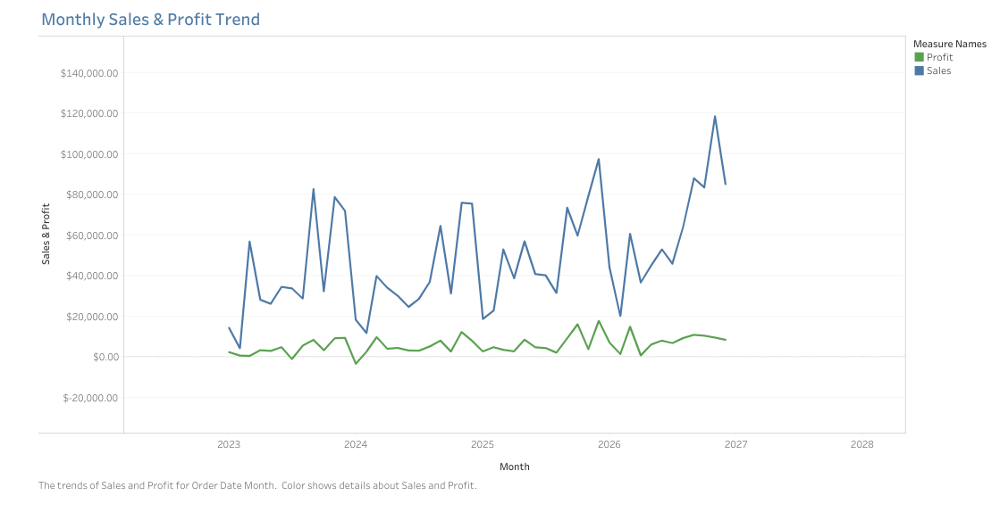
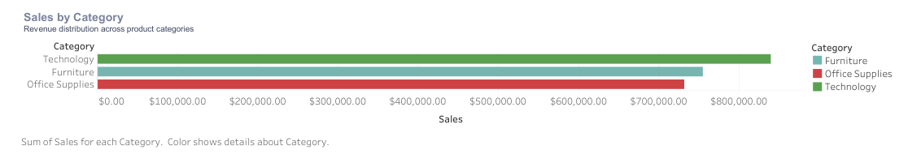
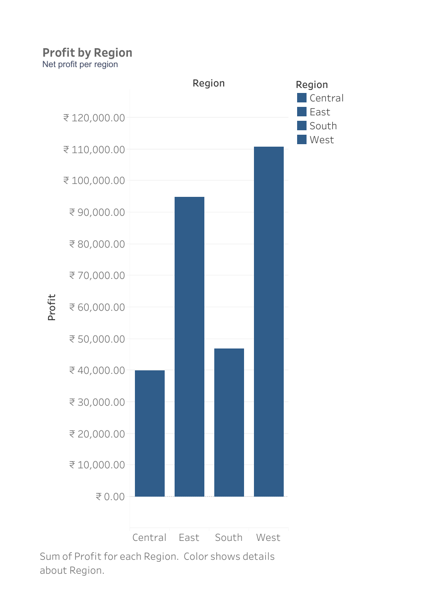
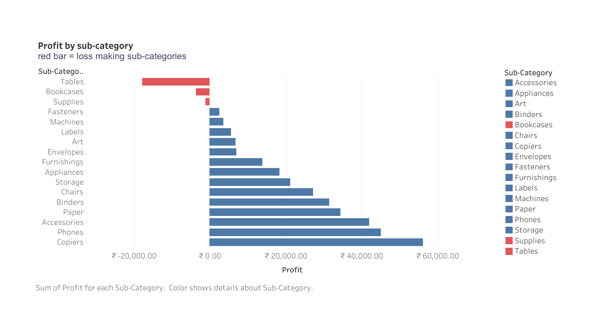

# GROW — Retail Sales & Profitability Analysis

**Data analytics portfolio case study | Excel • SQL • Python • Tableau**

## 1. Project Overview
GROW is a simulated retail analytics case study built with the Sample Superstore dataset. It explores sales and profitability, category and regional performance, sub-category results, discount patterns, and basic data quality.

> **Dataset disclosure:** This project uses sample data, not verified records from a real GROW business. The source data covers January 3, 2023 through December 30, 2026. The findings below describe this supplied dataset only.

## 2. Dashboard Preview


[Open the dashboard image](dashboard/grow_dashboard.png) · [Open the Tableau workbook](tableau/GROW_Tableau_Dashboard.twb)

## 3. Chart Gallery

### Monthly Sales and Profit Trend


### Sales by Category


### Profit by Region


### Profit by Sub-Category


## 4. Dataset and Quality Checks
- 10,194 transaction rows and 21 columns
- 5,111 distinct orders and 804 distinct customers
- The supplied checks found no missing cells, exact duplicate rows, duplicate Row IDs, or ship-before-order records.

## 5. Key Findings from the Sample Dataset
| Metric | Result |
|---|---:|
| Total sales | $2,326,534.35 |
| Total profit | $292,296.81 |
| Profit margin | 12.56% |
| Unique orders | 5,111 |
| Unique customers | 804 |
| Negative-profit line items | 1,901 (18.65%) |

- Technology recorded the highest category sales: $839,893.28.
- Tables recorded the lowest sub-category profit: -$17,753.21.
- Central recorded the lowest regional profit: $39,865.31.

These are descriptive results from the supplied sample file. They do not establish causes or represent verified results from an actual company.

## 6. Excel Workbook

[Open or download the GROW Analytics Excel Workbook](GROW_Analytics_Workbook.xlsx)

The Excel workbook is included in this repository and is intended for reviewing the raw data, KPI and data-quality summaries, category/region/monthly/sub-category/discount analysis tables, and two charts on the KPI Summary sheet. Open the `.xlsx` file in Microsoft Excel or a compatible spreadsheet application. Validation found static pre-calculated values rather than refreshable PivotTables or formula-driven summaries.

## 7. Tools and Analysis
- **Excel:** raw data, pre-calculated KPI and data-quality summaries, category/region/monthly/sub-category/discount analysis tables, and two charts on the KPI Summary sheet. The workbook does not contain refreshable PivotTables or formula-driven calculations.
- **SQL:** seven reusable SQLite-compatible analysis sections covering overall KPIs, category, region, sub-category, discount, monthly trends, and data-quality checks. See [`sql/grow_analysis.sql`](sql/grow_analysis.sql).
- **Python:** Pandas-based data-quality checks, KPI calculations, and category/region summaries.
- **Tableau:** one interactive dashboard, 12 worksheets, and 3 highlight actions.

### Tableau Worksheet Inventory
The Tableau workbook contains these 12 worksheets:

1. KPI - Total Profit
2. KPI - Total Sales
3. KPI - Profit Margin
4. KPI - Orders
5. KPI - Negative Profit
6. Monthly Sales and Profit Trend
7. Sales by Category
8. Profit by Region
9. Profit by Sub-Category
10. Sub-Category Highlight A
11. Sub-Category Highlight B
12. Regional Profit Highlight

The five KPI worksheets support the dashboard's headline metrics. The remaining worksheets provide time-trend, category, regional, sub-category, and highlight views. These are Tableau **worksheets**, not 12 separate automated workflows.

## 8. Project Structure
```text
GROW/
├── charts/
│   ├── monthly_sales_profit_trend.png
│   ├── profit_by_region.png
│   ├── profit_by_sub_category.png
│   └── sales_by_category.png
├── dashboard/
│   └── grow_dashboard.png
├── dataset/
│   └── samplesuperstore.csv
├── tableau/
│   ├── GROW_Tableau_Dashboard.twb
│   └── README.md
├── GROW_Analytics_Workbook.xlsx
├── GROW_Retail_Sales_&_Profitability.zip
└── grow_analysis.py
```

## 9. Open the Tableau Workbook
The standalone workbook is stored at [GROW_Tableau_Dashboard.twb](tableau/GROW_Tableau_Dashboard.twb). Its relative data connection points to `../dataset/samplesuperstore.csv`. Keep the `GROW/dataset` folder in place. If Tableau asks for the source file, select `GROW/dataset/samplesuperstore.csv`. The current downloadable ZIP does not contain this Tableau workbook; download it separately from the link above.

## 10. Run the Python Analysis
From the repository root:

```bash
pip install pandas
python GROW/grow_analysis.py GROW/dataset/samplesuperstore.csv
```

## 11. Limitations and Validation Notes
- The dataset is sample data and is not verified real-company data.
- Associations between discounts and profit are descriptive; they do not prove causation.
- The dataset's 2023–2026 date range should be treated as part of the supplied sample.
- The Tableau workbook's number formatting and the written KPI summary have previously shown different currency symbols. Confirm the intended currency in Tableau before presenting the figures externally.
- PNGs are static previews; the `.twb` file is the editable Tableau workbook.

---
*Created as a learning and portfolio project by Mohammad Abuzar.*