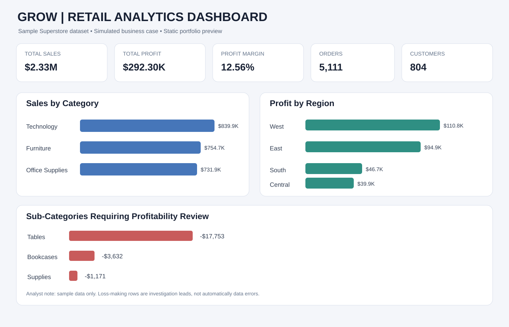

# GROW — Retail Sales & Profitability Analysis

**Junior Data Analyst portfolio project | Excel • SQL • Python • Power BI**

## Project overview
GROW is a simulated retail-business case study built with the supplied Sample Superstore dataset. It explores sales, profit, category and regional performance, sub-category profitability, discount patterns, and data quality.

> **Dataset note:** This is sample data, not verified data from a real GROW company. The source dates run from 3 Jan 2023 through 30 Dec 2026, which extends beyond 31 Oct 2026. Validate the date range before presenting it as historical performance.

## Dataset and quality checks
- 10,194 transaction rows and 21 columns
- 5,111 distinct orders and 804 distinct customers
- No missing cells, exact duplicate rows, duplicate Row IDs, or ship-before-order records detected by the supplied checks

## Key results from the supplied sample data
- **Total sales:** $2,326,534.35
- **Total profit:** $292,296.81
- **Profit margin:** 12.56%
- **Negative-profit line items:** 1,901 (18.65%)
- **Highest category sales:** Technology — $839,893.28
- **Lowest sub-category profit:** Tables — -$17,753.21
- **Lowest regional profit:** Central — $39,865.31

These are descriptive results from the sample file, not causal conclusions or claims about an actual company.

## Dashboard preview

## Visuals and project files
- `charts/` — bar chart for category sales, pie chart for category sales mix, regional profit bar chart, sub-category profit bar chart, monthly sales/profit line chart, and dashboard preview.
- `GROW_Analytics_Workbook.xlsx` — raw data, quality audit, KPI summary, analysis tables, and an Excel chart gallery.
- `samplesuperstore.csv` — source sample dataset.
- `grow_analysis.py` — reproducible Python analysis.
- `grow_analysis.sql` — SQLite-compatible business queries.
- `PowerBI_DAX_Measures.txt` — DAX measures and suggested Power BI layout.
- `Project_Report.pdf` and `GROW_Project_Report.pdf` — supplied project reports.

## Power BI report plan
Import the `Analysis_Data` sheet into Power BI Desktop. Add KPI cards for sales, profit, margin, order count, and customer count; a monthly line chart; category sales and sub-category profit bar charts; and regional profit comparison. Add slicers for order date, region, category, segment, and ship mode. Use a proper Date table for time intelligence.

**Important:** The images are static portfolio charts generated from the workbook data. They are not screenshots of an interactive Power BI `.pbix` report.

## Analyst cautions
- Confirm the unusual future-dated portion of the sample before final presentation.
- Negative-profit rows are not automatically data errors.
- Discount-profit association is descriptive and does not prove discounts caused losses.
- Currency formatting follows the dollar values in the supplied sample file.

**Status:** Analysis and static chart pack prepared; interactive Power BI report can be built separately in Power BI Desktop.
