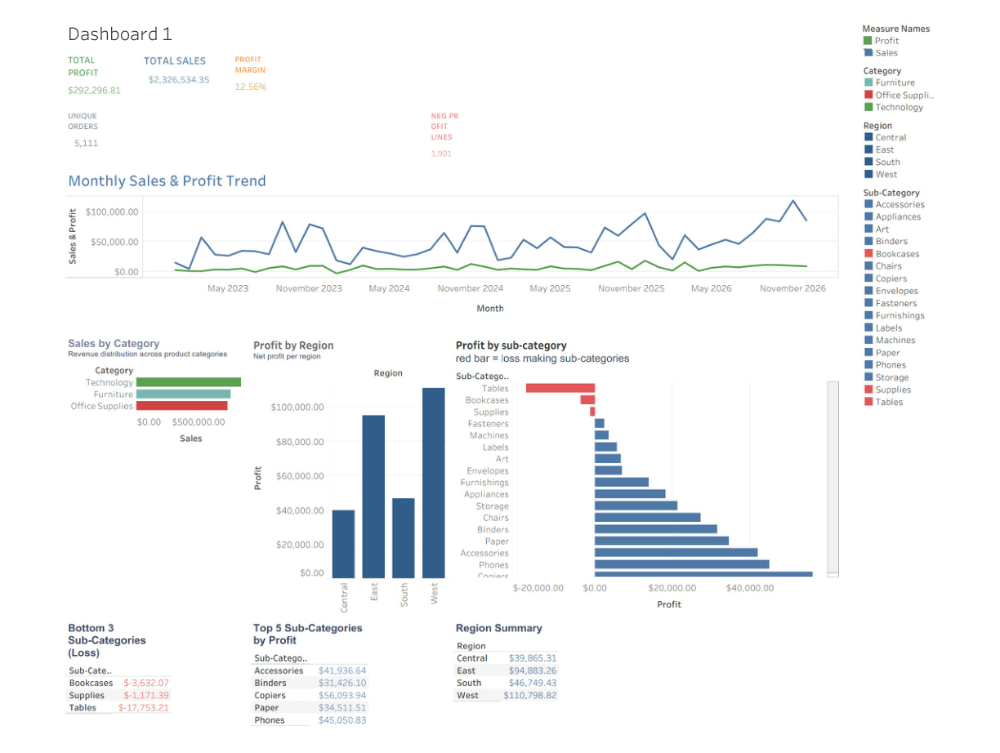
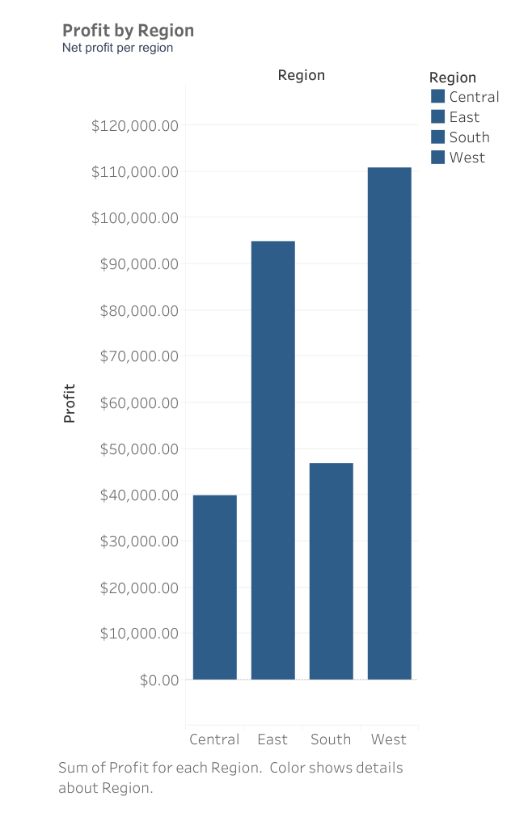
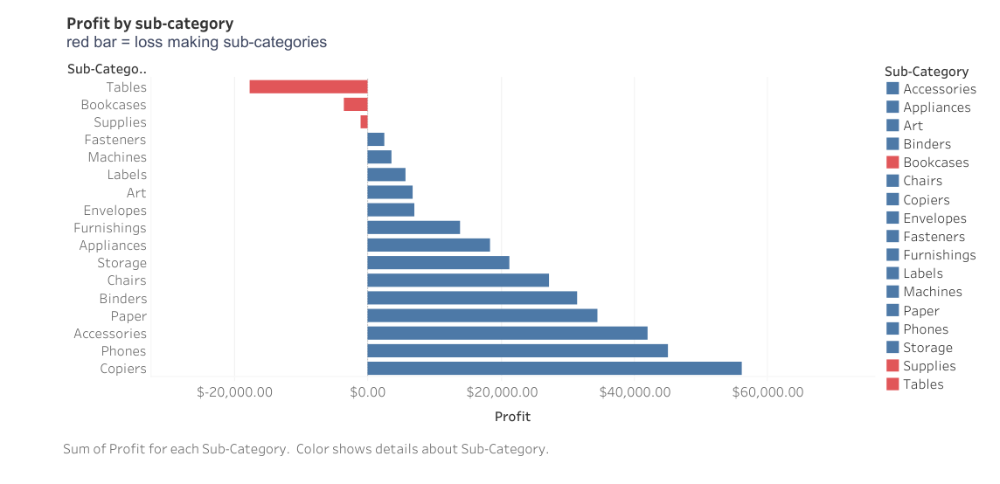

# GROW — Retail Sales & Profitability Analysis

**Data analytics portfolio case study** · Excel · SQL · Python · Tableau

## Project Overview

GROW is a retail analytics case study using the Sample Superstore dataset. It explores sales, profit, profit margin, category and regional performance, sub-category profitability, monthly trends, and data quality.

> **Dataset disclosure:** This is sample data, not verified records from a real company. Findings describe only the supplied dataset.

## Tableau Dashboard



[Open the dashboard image](dashbord_page_1.png) · [Open the Tableau workbook](tableau/GROW_Tableau_Dashboard.twb)

## Chart Gallery

### Sales by Category


### Profit by Region


### Profit by Sub-Category


### Monthly Sales and Profit Trend


## Key Performance Indicators

| Metric | Result |
|---|---:|
| Total Sales | $2,326,534.35 |
| Total Profit | $292,296.81 |
| Profit Margin | 12.56% |
| Distinct Orders | 5,111 |
| Distinct Customers | 804 |
| Negative-Profit Line Items | 1,901 |

## Key Findings

- Technology has the highest sales among the three categories.
- Tables are the lowest-profit sub-category and show a negative total profit.
- The West region records the highest profit among the four regions.
- The monthly view shows sales and profit movement across the supplied date range.

These are descriptive findings; they do not establish causation or represent verified company results.

## Tools and Workflow

- **Excel:** KPI summaries, data-quality review, analysis tables, and charts.
- **SQL:** queries for overall KPIs, category, region, sub-category, discount, monthly trends, and data-quality checks.
- **Python:** data cleaning checks, KPI calculations, and summary analysis with Pandas.
- **Tableau:** interactive dashboard and worksheet-based visual analysis.

## Project Files

| Resource | Link |
|---|---|
| Excel analysis workbook | [GROW Analytics Workbook](GROW_Analytics_Workbook.xlsx) |
| Python analysis | [grow_analysis.py](grow_analysis.py) |
| SQL analysis | [SQL folder](sql/) |
| Dataset | [Dataset folder](dataset/) |
| Tableau workbook | [GROW Tableau Dashboard](tableau/GROW_Tableau_Dashboard.twb) |

## Repository Layout

The newly uploaded chart and dashboard previews are currently stored in the GROW project root. The links above point to their current committed locations. The Tableau workbook is stored in `tableau/`. The preview files still need to be moved into dedicated `charts/` and `dashboard/` folders to complete the requested folder structure.

```text
GROW/
├── charts/                 # destination for the four chart previews
├── dashboard/              # destination for the dashboard preview
├── dataset/
├── sql/
├── tableau/
│   └── GROW_Tableau_Dashboard.twb
├── GROW_Analytics_Workbook.xlsx
├── grow_analysis.py
└── README.md
```

## Running the Python Analysis

From the repository root:

```bash
pip install pandas
python GROW/grow_analysis.py GROW/dataset/samplesuperstore.csv
```

## Notes and Limitations

- The dataset is sample data and must not be presented as verified company data.
- Sales and Profit are displayed in USD ($) in the supplied Tableau visuals.
- Discount/profit relationships are descriptive and do not establish causation.
- PNG files are static previews; the `.twb` file is the editable Tableau workbook.

---

*Portfolio project by Mohammad Abuzar.*
